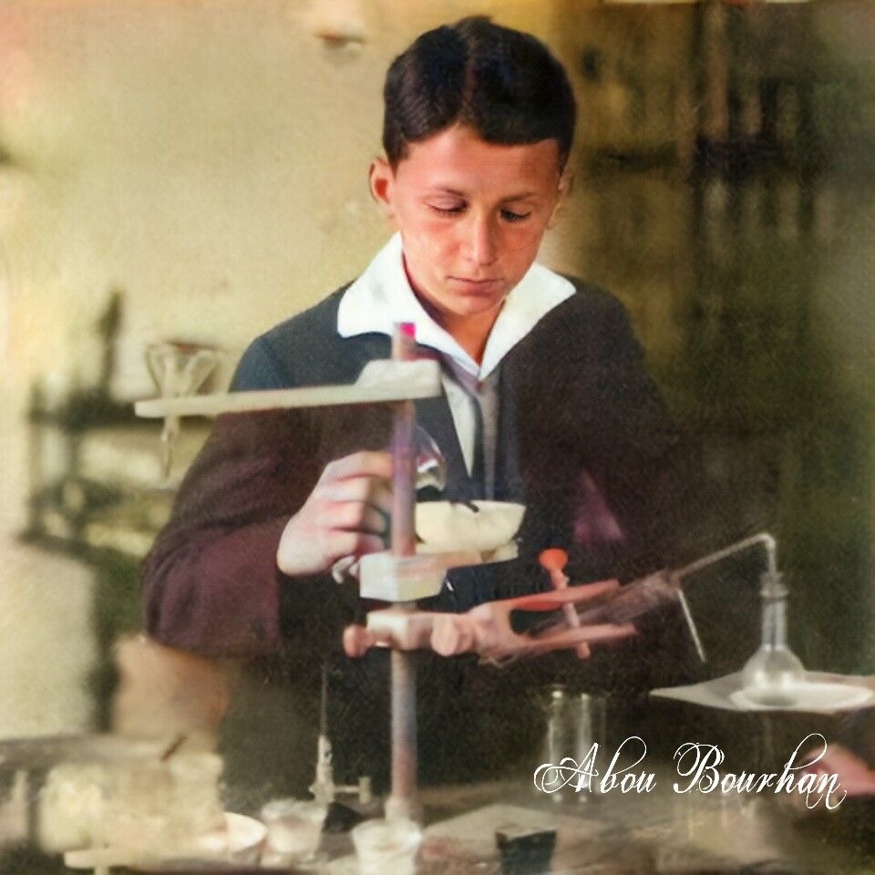

#### Qui est-ce? {.sous-titre}
Nikola Tesla est un inventeur et ingénieur qui a profondément marqué l’histoire de l’électricité. Il est surtout connu pour ses travaux sur le courant alternatif, qui est aujourd’hui utilisé dans le monde entier pour transporter l’énergie électrique. Ses idées ont permis de moderniser complètement les systèmes électriques.

#### Enfance et origine {.sous-titre}
Nikola Tesla est né le 10 juillet 1856 dans une région qui fait aujourd’hui partie de la Croatie, à l’époque dans l’Empire austro-hongrois. Il vient d’une famille serbe. Son père était prêtre et sa mère était très créative et ingénieuse, ce qui a beaucoup influencé Tesla.     Dès son enfance, il possède une mémoire exceptionnelle et une grande curiosité pour les sciences.  

#### Etudes et formations {.sous-titre}
À l’âge de 19 ans (vers 1875), Tesla commence ses études en ingénierie électrique à l’École polytechnique de Graz en Autriche. C’est là qu’il découvre les machines électriques et développe un fort intérêt pour les moteurs électriques.  En 1878, il quitte parfois ses études de manière irrégulière et s’isole pour réfléchir à ses inventions. Il s’inscrit ensuite à l’Université de Prague en 1880, où il continue ses études en physique et mathématiques, mais il ne termine pas complètement son diplôme.  

- 1875 : début des études à Graz (19 ans)
- Découverte des machines électriques
- 1878 : premières idées d’inventions
- 1880 : études à Prague
- Formation incomplète mais avancée

#### Départ aux États-Unis {.sous-titre}
En 1884, à l’âge de 28 ans, Tesla émigre aux États-Unis pour travailler dans l’industrie électrique. Il arrive à New York avec très peu d’argent mais beaucoup d’idées.  Il est engagé brièvement par Thomas Edison, mais leurs visions scientifiques sont très différentes. Edison travaille sur le courant continu, tandis que Tesla défend le courant alternatif, ce qui provoque une séparation rapide entre eux.