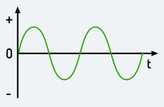
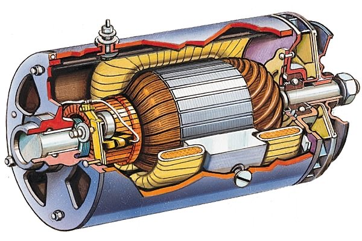
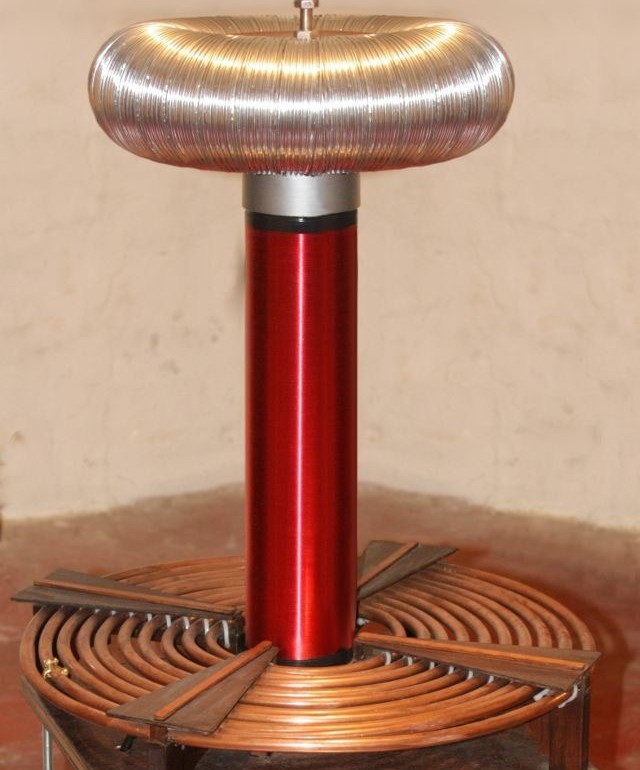
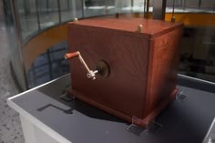

Les inventions de Nikola Tesla ont profondément transformé le monde moderne. Grâce à ses travaux, l’électricité est devenue plus efficace, plus accessible et mieux adaptée aux besoins industriels et domestiques. Beaucoup de ses idées sont encore utilisées aujourd’hui dans les technologies actuelles.

#### Le courant alternatif (AC) {.sous-titre}
Le courant alternatif est l’une des inventions les plus importantes de Tesla. Développé dans les années 1880, il permet de transporter l’électricité sur de très longues distances avec très peu de pertes d’énergie. Contrairement au courant continu, il change de direction plusieurs fois par seconde. Cette innovation a permis la création des réseaux électriques modernes qui alimentent les villes entières.

#### Le moteur à induction {.sous-titre}
Inventé en 1887-1888, le moteur à induction fonctionne grâce à un champ magnétique tournant créé par le courant alternatif. Ce système permet de transformer l’énergie électrique en énergie mécanique sans contact direct entre les pièces, ce qui le rend très fiable et durable. Il est encore utilisé aujourd’hui dans les ventilateurs, machines industrielles et appareils électroménagers.

- Utilise le courant alternatif
- Crée un champ magnétique
- Fait tourner le moteur
- Utilisé dans l’industrie aujourd’hui

#### La bobine de Tesla {.sous-titre}
La bobine de Tesla, inventée en 1891, est un dispositif capable de produire des tensions électriques extrêmement élevées. Elle permet de générer des décharges spectaculaires et a été utilisée pour expérimenter la transmission sans fil de l’électricité. Même si elle n’est pas utilisée directement dans les réseaux modernes, elle reste très importante pour la recherche scientifique.

#### La télécommande sans fil {.sous-titre}
En 1898, Tesla présente une invention révolutionnaire : un bateau télécommandé à distance grâce aux ondes radio. C’est l’un des premiers exemples de contrôle sans fil d’un appareil. Cette invention a posé les bases des technologies modernes comme les drones, les télécommandes et les systèmes connectés.

#### Tableau des principales inventions {.sous-titre}

| photo | invention | année | utilité |
| :---: |:---: |:---: |:---: |
|  | Courant alternatif | 1887 | Transport d’énergie |
|  | Moteur à induction | 1888 | Production de mouvement |
|  | Bobine de Tesla | 1891 | Haute tension |
|  | Télécommande sans fil | 1898 | Contrôle d’objets à distance |

